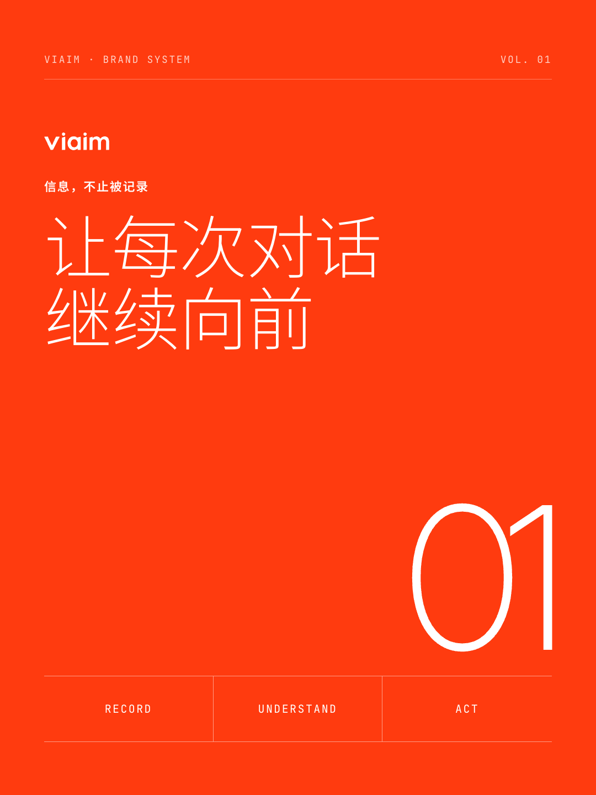
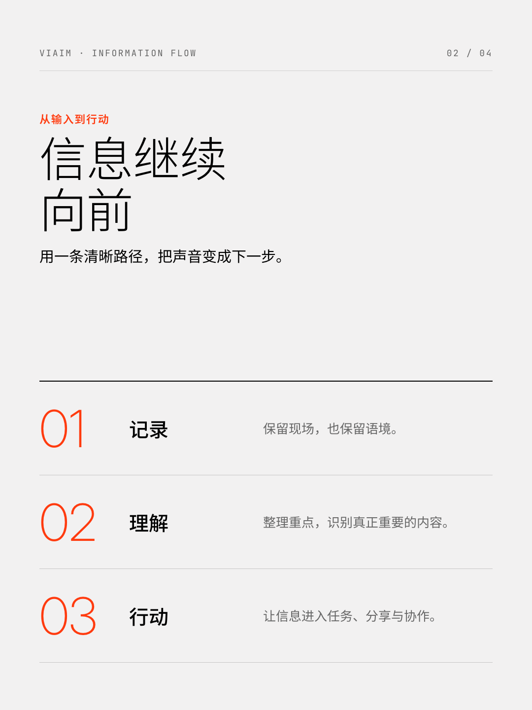
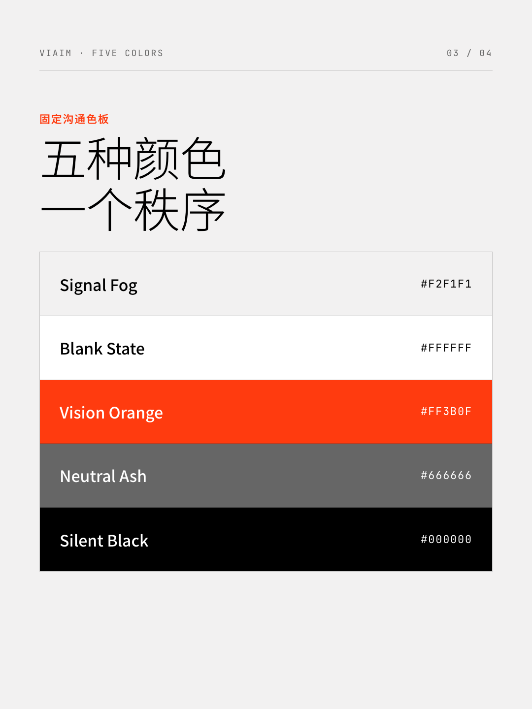
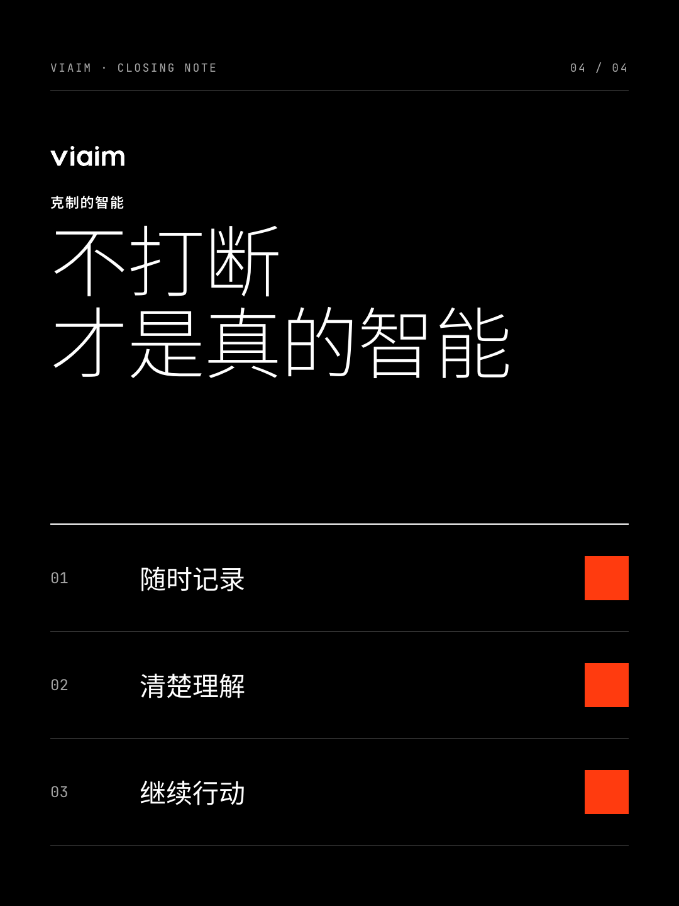

# viaim Social Card Skill


面向 Codex、Claude Code 等本地 Agent 的 viaim 品牌图文卡片 Skill。它把文章、产品笔记、截图、照片或视频整理为：

- 小红书 / Rednote 1080×1440 图文组图
- 微信公众号 2100×900 头图与 1080×1080 分享卡
- 用户视频驱动的 Live Photo 动态卡

视觉层固定使用 viaim 五色沟通体系，不再开放任意主题色：

| Token | Hex | 用途 |
| --- | --- | --- |
| Signal Fog | `#F2F1F1` | 默认背景 |
| Blank State | `#FFFFFF` | 高对比表面与橙色表面文字 |
| Vision Orange | `#FF3B0F` | 唯一高饱和强调色 |
| Neutral Ash | `#666666` | 次级信息 |
| Silent Black | `#000000` | 主文字与深色表面 |

## 示例

| 品牌封面 | 信息流 |
| --- | --- |
|  |  |

| 五色系统 | 深色收尾 |
| --- | --- |
|  |  |

## 安装

```bash
npx skills add https://github.com/visiondesignlab/viaim-social-card-skill --skill viaim-social-card-skill
```

也可以直接克隆：

```bash
git clone https://github.com/visiondesignlab/viaim-social-card-skill.git ~/.codex/skills/viaim-social-card-skill
cd ~/.codex/skills/viaim-social-card-skill
npm ci
```

## 使用

安装后可以直接告诉 Agent：

```text
用 viaim-social-card-skill 把这篇文章做成 5 张小红书图文。
把这份产品说明做成 viaim 品牌风格的公众号封面对。
用这段视频生成一张 viaim 风格的小红书 Live Photo 卡片。
```

Skill 会先规划内容与版式，再从种子模板建立任务目录，通过 Playwright 输出固定尺寸 PNG。详细流程见 [`SKILL.md`](./SKILL.md)。

## 品牌约束

- Vision Orange 是唯一高饱和强调色。
- 橙色表面只能使用 Blank State 白色文字。
- 不使用渐变、圆角、阴影或装饰性彩色图形。
- Logo 始终来自 `assets/viaim-logo/viaim-logo-master.svg`，保持 118:32 比例，不修改路径、不裁切、不扭曲。
- 每张卡优先表达一个观点；信息不足时删减文案，不缩小到移动端不可读。

完整规范见 [`references/viaim-brand-system.md`](./references/viaim-brand-system.md)。

## 渲染与校验

```bash
npm ci
node scripts/render.mjs path/to/task-dir
npm run validate:brand
node validate-social-deck.mjs path/to/task-dir --style=swiss
```

品牌校验会检查固定五色、两套模板、Skill 文档和官方 Logo 母版哈希。版式校验基于真实浏览器渲染，检查溢出、字号和画板边界。

## 项目结构

```text
viaim-social-card-skill/
├── SKILL.md
├── agents/
├── assets/
│   ├── template-editorial-card.html
│   ├── template-swiss-card.html
│   └── viaim-logo/
├── examples/
├── references/
├── scripts/
└── validate-social-deck.mjs
```

## 许可

代码与文档按 [`AGPL-3.0-only`](./LICENSE) 发布。来源说明见 [`NOTICE.md`](./NOTICE.md)。viaim 名称、Logo 与品牌资产的使用仍受品牌权利约束。
